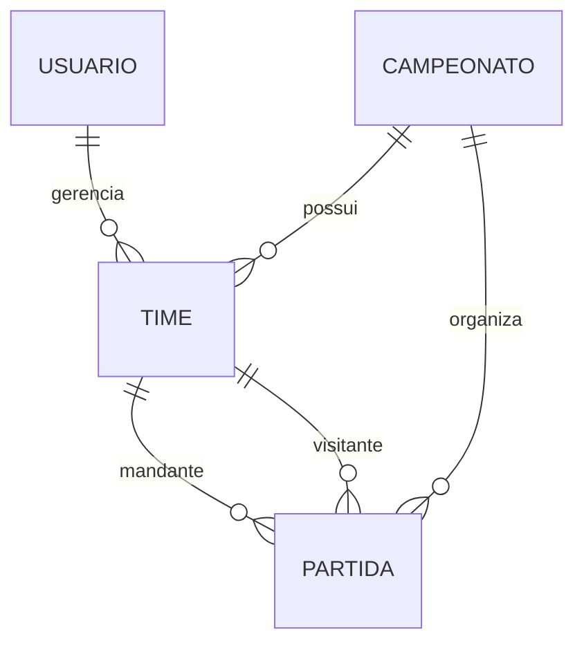
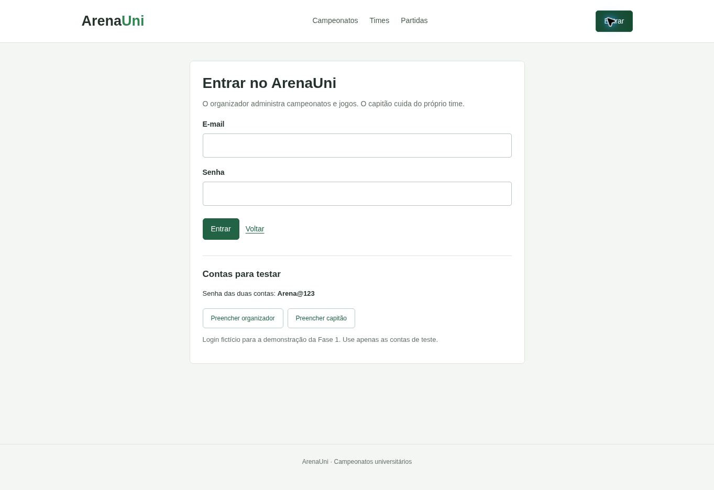
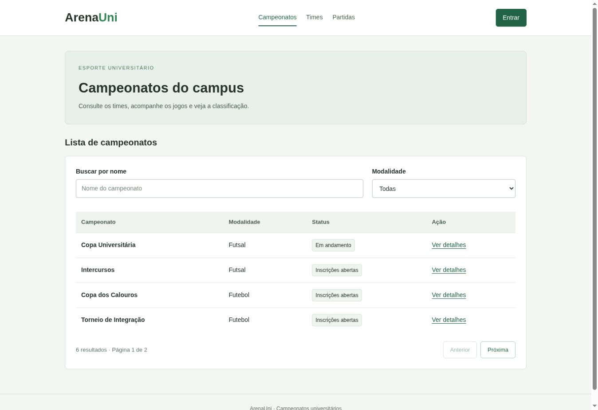
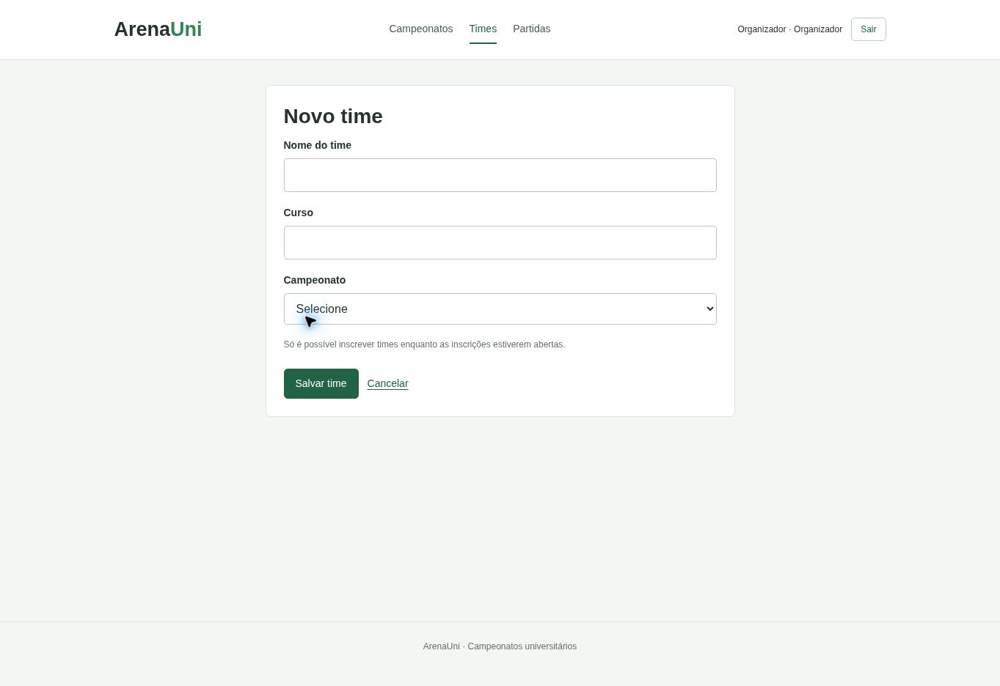
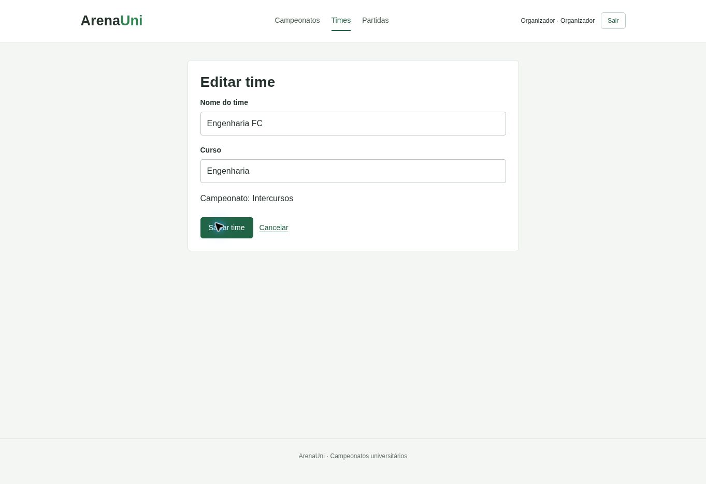
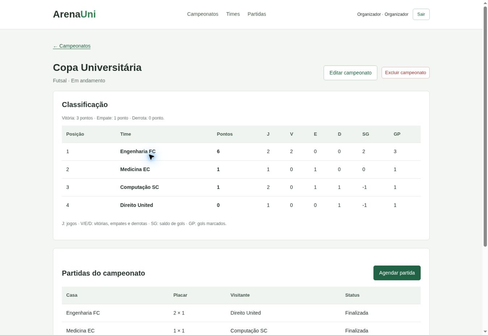

# ArenaUni — Frontend

Aplicação em **React** para organizar e acompanhar campeonatos universitários de futebol e futsal. Esta entrega corresponde ao **frontend da Fase 1**, com dados e login simulados no navegador.

## 1. Identificação e integrantes

- **Projeto:** ArenaUni.
- **Curso:** Sistemas de Informação — 4º período.
- **Etapa:** frontend em React, utilizando Vite e React Router.

### Equipe e responsabilidades

| Integrante                                | E-mail                        | Papel / responsabilidade                                                                                                          |
| ----------------------------------------- | ----------------------------- | --------------------------------------------------------------------------------------------------------------------------------- |
| Ryan Aguiar Moreira                       | ryanaguiar0501@gmail.com      | **Times e validações:** cadastro, edição e exclusão de times; validação dos formulários e das regras de inscrição e propriedade.  |
| Pedro Henrique Vidal                      |  pedroheriquevidal3@gmail.com | **Campeonatos e partidas:** formulários de campeonatos, agendamento dos jogos, lançamento de placares e cálculo da classificação. |
| João Pedro Nascimento Cavalcanti Abrantes | joaopedroabrantespb@gmail.com | **Autenticação e navegação:** login com Context API, rotas protegidas, navegação entre páginas e CSS responsivo.                  |
| Pedro Isaac Lopes Ramos Souza             | isaacbarbosapib7@gmail.com    | **Listagens:** exibição de campeonatos, times e partidas; filtros, paginação e estados de carregamento, erro e lista vazia.       |

A tabela define a divisão de responsabilidades. Cada integrante deve registrar suas contribuições reais com a própria conta no GitHub e apresentar a parte que desenvolveu. A documentação e a revisão final são realizadas em conjunto.

## 2. Definição da aplicação

### Problema

Campeonatos universitários costumam ter informações distribuídas entre planilhas e grupos de mensagens. Isso dificulta encontrar os próximos jogos, consultar os times e manter a classificação correta após cada resultado.

### Solução

O ArenaUni reúne campeonatos, times e partidas em uma aplicação. O organizador cadastra os campeonatos, agenda confrontos e lança os placares. O capitão inscreve e gerencia seus times. Os visitantes acompanham os campeonatos e a classificação, calculada automaticamente a partir das partidas finalizadas.

### Público-alvo

- Organizadores de campeonatos, atléticas e representantes de cursos.
- Capitães e responsáveis pelos times universitários.
- Estudantes e demais pessoas que acompanham os jogos.

### Contexto de uso

O sistema é acessado pelo navegador, em computador ou celular, antes e durante os eventos esportivos do campus. A interface permite consultar informações rapidamente sem depender de mensagens enviadas pela organização.

## 3. Escopo da Fase 1

### Funcionalidades implementadas

- Criar, listar, consultar detalhes, editar e excluir campeonatos.
- Criar, listar, editar e excluir times vinculados aos campeonatos.
- Buscar campeonatos por nome e modalidade, com paginação.
- Buscar times por nome/curso e campeonato, com paginação.
- Listar e filtrar partidas por campeonato.
- Agendar partidas e registrar placares.
- Excluir partidas ainda agendadas e cancelar partidas finalizadas.
- Atualizar a classificação automaticamente após resultados ou cancelamentos.
- Simular login de organizador e capitão, com Context API e rotas por perfil.
- Manter dados e login após recarregar a página, utilizando `localStorage`.
- Exibir validações, mensagens de sucesso e estados de carregamento, erro e vazio.

### Limites desta entrega

Esta é a versão simplificada do frontend. Não inclui cadastro de jogadores, artilharia, dashboard separado, cadastro de usuários, reagendamento ou regras de pontuação de vôlei e basquete. A página inicial funciona como listagem principal com filtros.

**Ainda não existe API REST, banco de dados ou autenticação real.** O Node.js executa as ferramentas do projeto, principalmente o Vite. O login utiliza contas fictícias, e os dados são salvos separadamente em cada navegador/endereço. As alterações não são compartilhadas entre computadores.

O escopo desta versão é menor que o da proposta inicial do projeto; os recursos retirados estão identificados acima. A integração com servidor e banco é uma etapa posterior.

## 4. Modelagem de dados e entidades relacionadas

O frontend trabalha com **Campeonato, Time e Partida**, além do usuário usado para demonstrar os perfis de acesso. As entidades são representadas por objetos JavaScript; ainda não são tabelas de um banco.

### Diagrama dos relacionamentos



### Campos das entidades

| Entidade                 | Campos principais                                                                                                                                                                                       |
| ------------------------ | ------------------------------------------------------------------------------------------------------------------------------------------------------------------------------------------------------- |
| Usuário / conta de teste | `id`: número; `nome`: texto; `email`: texto usado no login; `perfil`: `organizador` ou `capitao`.                                                                                                       |
| Campeonato               | `id`: número; `nome`: texto; `modalidade`: `Futsal` ou `Futebol`; `status`: `Inscrições abertas`, `Em andamento` ou `Encerrado`; `inicio` e `fim`: datas em texto no formato `AAAA-MM-DD`.              |
| Time                     | `id`: número; `nome`: texto; `curso`: texto; `campeonatoId`: identificador do campeonato; `capitaoId`: identificador do responsável.                                                                    |
| Partida                  | `id`: número; `campeonatoId`, `casaId` e `foraId`: identificadores; `data`: data e hora; `local`: texto; `golsCasa` e `golsFora`: números ou `null`; `status`: `Agendada`, `Finalizada` ou `Cancelada`. |

As contas fictícias estão em `AuthContext.jsx`. Após o login, apenas `id`, `nome` e `perfil` são guardados na sessão local; a senha não é persistida nela.

### Descrição das relações

1. Um campeonato pode possuir vários times. Cada time pertence a um campeonato, indicado por `campeonatoId`.
2. Um usuário pode ser responsável por vários times, identificado por `capitaoId`.
3. Um campeonato pode possuir várias partidas. Cada partida pertence a um campeonato.
4. Cada partida tem exatamente dois times diferentes: um mandante (`casaId`) e um visitante (`foraId`). Um time pode participar de várias partidas em qualquer um desses papéis.

As entidades **Campeonato e Time** já atendem ao mínimo de duas entidades relacionadas. A entidade Partida permite demonstrar o lançamento de resultados e a classificação.

### Regras de negócio

| Regra                | Comportamento                                                                                                                                                      |
| -------------------- | ------------------------------------------------------------------------------------------------------------------------------------------------------------------ |
| Perfis de acesso     | O organizador administra campeonatos e partidas. O capitão edita e exclui somente seus próprios times. Visitantes consultam campeonatos, partidas e classificação. |
| Inscrições           | Um novo time só pode ser cadastrado em um campeonato com inscrições abertas.                                                                                       |
| Nome do time         | Não pode existir outro time com o mesmo nome dentro do mesmo campeonato, desconsiderando maiúsculas/minúsculas e espaços nas extremidades.                         |
| Início do campeonato | São necessários pelo menos quatro times para alterar o status para Em andamento.                                                                                   |
| Datas do campeonato  | A data final deve ser posterior à inicial.                                                                                                                         |
| Mudança de status    | Um campeonato em andamento não volta às inscrições; um campeonato encerrado não pode ser reaberto.                                                                 |
| Agendamento          | Só é permitido em campeonato em andamento, com times diferentes e pertencentes ao campeonato escolhido.                                                            |
| Data da partida      | Deve estar dentro do período do campeonato; um time não pode ter outra partida no mesmo horário.                                                                   |
| Placar               | Os valores devem ser inteiros maiores ou iguais a zero. Apenas uma partida agendada pode receber resultado.                                                        |
| Classificação        | Vitória vale 3 pontos; empate, 1; derrota, 0. O desempate usa vitórias, saldo de gols e gols marcados.                                                             |
| Cancelamento         | Partidas canceladas deixam de contar na classificação.                                                                                                             |
| Exclusão             | Campeonatos e times com partidas finalizadas não podem ser excluídos. A exclusão permitida remove também os registros dependentes da versão local.                 |

As verificações desta fase são feitas no frontend para demonstração. Quando houver backend, as permissões e regras também precisarão ser verificadas no servidor.

## 5. Especificação do frontend e mapa de rotas

As páginas são navegadas com **React Router**. As rotas estão definidas em `src/App.jsx`.

| Rota                      | Página                      | Acesso / função                                                             |
| ------------------------- | --------------------------- | --------------------------------------------------------------------------- |
| `/`                       | Campeonatos                 | Pública. Listagem com busca por nome, filtro por modalidade e paginação.    |
| `/login`                  | Login                       | Pública. Entrada com conta fictícia de organizador ou capitão.              |
| `/campeonatos/:id`        | Detalhes do campeonato      | Pública. Exibe classificação e partidas do campeonato selecionado.          |
| `/campeonatos/novo`       | Novo campeonato             | Organizador. Formulário de cadastro.                                        |
| `/campeonatos/:id/editar` | Editar campeonato           | Organizador. Alteração de dados e status.                                   |
| `/times`                  | Times                       | Autenticado. Listagem com filtros e paginação.                              |
| `/times/novo`             | Novo time                   | Autenticado. Inscrição em um campeonato aberto.                             |
| `/times/:id/editar`       | Editar time                 | Responsável pelo time ou organizador.                                       |
| `/partidas`               | Partidas                    | Pública. Lista confrontos, datas, locais e placares; filtra por campeonato. |
| `/partidas/nova`          | Agendar partida             | Organizador. Seleciona campeonato, times, data, hora e local.               |
| `/partidas/:id/resultado` | Lançar resultado            | Organizador. Registra o placar de uma partida agendada.                     |
| `*`                       | Página não encontrada — 404 | Pública. Informa que o endereço não existe e oferece retorno ao início.     |

Sem login, as páginas privadas redirecionam para `/login`. Uma pessoa com perfil incompatível recebe a tela **Acesso negado**. As telas de edição de times também verificam o responsável pelo registro.

## 6. Telas / protótipos da interface

As imagens abaixo mostram as telas implementadas na versão simplificada. Os arquivos estão em `docs/telas` e devem ser enviados junto com o README para que apareçam no GitHub.

### 6.1 Login

Campos de e-mail e senha, botão Entrar e contas fictícias para demonstrar os dois perfis.



### 6.2 Listagem principal com filtros

Mostra o nome, a modalidade e o status dos campeonatos. A busca por texto e o filtro de modalidade podem ser combinados. Os botões Anterior e Próxima controlam a paginação.



### 6.3 Formulário de cadastro de time

Solicita nome, curso e campeonato com inscrições abertas. Ao salvar, valida os campos e verifica se há outro time com o mesmo nome naquele campeonato.



### 6.4 Formulário de edição de time

Exibe os dados atuais do time. O formulário é aberto apenas pelo responsável ou pelo organizador; o campeonato vinculado é mantido.



### 6.5 Detalhe e classificação do campeonato

A rota dinâmica identifica o campeonato e apresenta a classificação calculada a partir dos resultados, além dos confrontos cadastrados.



## 7. UX, validações e estados da interface

### 7.1 Mensagens de erro e validação

As mensagens aparecem perto do formulário, sem apagar os valores digitados. Depois de uma operação concluída, o sistema exibe uma mensagem de sucesso.

| Situação                                  | Mensagem exibida                                               |
| ----------------------------------------- | -------------------------------------------------------------- |
| Login com campos vazios                   | “Preencha o e-mail e a senha.”                                 |
| E-mail em formato inválido                | “Informe um e-mail válido.”                                    |
| Credenciais incorretas                    | “E-mail ou senha incorretos.”                                  |
| Nome do campeonato muito curto            | “O nome deve ter pelo menos 3 caracteres.”                     |
| Datas ausentes ou em ordem incorreta      | “Informe as datas. A data final deve ser posterior à inicial.” |
| Tentativa de iniciar com poucos times     | “Cadastre pelo menos 4 times antes de iniciar o campeonato.”   |
| Nome/curso do time vazios ou muito curtos | “Preencha nome e curso com pelo menos 2 caracteres.”           |
| Time sem campeonato aberto válido         | “Escolha um campeonato com inscrições abertas.”                |
| Time com nome repetido                    | “Já existe um time com esse nome neste campeonato.”            |
| Partida com dados obrigatórios ausentes   | “Preencha campeonato, times, data, hora e local.”              |
| Mesmo time nos dois lados                 | “Escolha dois times diferentes.”                               |
| Conflito de horário                       | “Um dos times já tem partida nesse horário.”                   |
| Placar negativo, vazio ou fracionário     | “Informe placares inteiros maiores ou iguais a zero.”          |
| Exclusão de time com resultado registrado | “Não é possível excluir um time com partidas finalizadas.”     |

As exclusões permitidas e a finalização de resultados pedem confirmação. Exemplos de sucesso: **Time cadastrado**, **Campeonato atualizado** e **Resultado salvo. A classificação foi atualizada.**

### 7.2 Carregamento, erro de comunicação e lista vazia

| Estado                | Tratamento atual                                                                                              | Como demonstrar                                                                                                                   |
| --------------------- | ------------------------------------------------------------------------------------------------------------- | --------------------------------------------------------------------------------------------------------------------------------- |
| Carregamento          | Exibe “Carregando dados...” enquanto aguarda a leitura simulada.                                              | Abrir/recarregar a aplicação. A espera simulada é de 400 ms.                                                                      |
| Falha de carregamento | Exibe “Não foi possível carregar os dados. Tente novamente.” e o botão Tentar novamente.                      | Em `src/dados.js`, mudar temporariamente `SIMULAR_ERRO` para `true`. Depois voltar para `false` e tentar novamente ou recarregar. |
| Lista vazia           | Exibe mensagens como “Nenhum campeonato encontrado. Altere ou limpe os filtros.” ou “Nenhum time encontrado.” | Buscar um nome inexistente, como “Sem resultados”.                                                                                |
| Sem permissão         | Exibe Acesso negado e uma opção para voltar.                                                                  | Entrar como capitão e abrir uma rota exclusiva do organizador.                                                                    |
| Endereço inexistente  | Exibe a página 404 com link para o início.                                                                    | Abrir um endereço que não corresponda a uma rota.                                                                                 |

**Comunicação com API:** nesta fase, a leitura é simulada pela função assíncrona `carregarDados()`; não existem requisições HTTP para um backend. Quando a API REST for integrada, os estados de carregamento e erro serão acionados pelas requisições, preservando a mensagem e a ação de nova tentativa. A falha demonstrada atualmente é uma simulação de comunicação, não uma chamada real à API.

### 7.3 Responsividade e acessibilidade básica

- Layout adaptado para computador e celular com CSS responsivo.
- Tabelas com rolagem horizontal quando o conteúdo não cabe na tela.
- Campos com rótulos e botões/links acessíveis pelo teclado.
- Destaque de foco visível, mensagens com `role="alert"`/`role="status"` e link para pular para o conteúdo.
- Navegação por Tab deve ser demonstrada durante a apresentação.

## 8. Tecnologias e organização

| Tecnologia / recurso     | Uso                                              |
| ------------------------ | ------------------------------------------------ |
| React                    | Componentes e atualização da interface.          |
| Vite                     | Servidor de desenvolvimento e compilação.        |
| React Router             | Navegação e rotas dinâmicas.                     |
| Context API              | Compartilhamento do usuário conectado.           |
| `useState` e `useEffect` | Estados dos campos/telas e carregamento inicial. |
| HTML e CSS               | Estrutura, formulários e responsividade.         |
| `localStorage`           | Persistência local dos dados fictícios.          |

| Arquivo / pasta                    | Responsabilidade                                        |
| ---------------------------------- | ------------------------------------------------------- |
| `src/App.jsx`                      | Navegação, rotas, carregamento e atualização dos dados. |
| `src/context/AuthContext.jsx`      | Contas de teste, usuário conectado e login/logout.      |
| `src/components/RotaProtegida.jsx` | Verificação de login e perfil.                          |
| `src/dados.js`                     | Dados iniciais e leitura/gravação local.                |
| `src/classificacao.js`             | Cálculo dos pontos, jogos e saldo de gols.              |
| `src/pages/`                       | Páginas e formulários separados por responsabilidade.   |
| `src/style.css`                    | Estilos da aplicação.                                   |
| `docs/telas/`                      | Imagens das interfaces usadas neste README.             |

## 9. Como executar

É necessário ter Node.js instalado. Extraia o projeto e abra a pasta que contém `package.json`.

No Windows, abra **INICIAR_WINDOWS.bat**. Ele entra na pasta correta, instala as dependências se necessário e inicia o Vite. Mantenha o terminal aberto enquanto usa o site.

Pelo terminal do VS Code, execute:

```bash
npm.cmd install
npm.cmd run dev
```

Em Linux/macOS, use `npm` no lugar de `npm.cmd`. Abra o endereço mostrado ao lado de **Local**, normalmente `http://localhost:5173/`.

Para verificar a compilação:

```bash
npm.cmd run build
```

### Contas fictícias para demonstração

| Perfil          | E-mail                    | Senha     |
| --------------- | ------------------------- | --------- |
| Organizador     | organizador@arenauni.demo | Arena@123 |
| Capitão (Lucas) | capitao@arenauni.demo     | Arena@123 |

Os botões da tela de login preenchem as contas. O capitão Lucas gerencia Engenharia FC e Computação SC. Os demais times dos dados de exemplo pertencem a outro responsável fictício. Use apenas dados de teste.

## 10. Entrega e apresentação

**O item a entregar na atividade é o link para o repositório com o frontend do grupo**, com este README na raiz, o código-fonte e a pasta `docs/telas`. O endereço da aplicação em execução não substitui o link do repositório.

O histórico do GitHub deve conter contribuições reais de todos os integrantes. A divisão indicada neste README não comprova, por si só, os commits de cada pessoa.

Na apresentação, o grupo deve mostrar: problema e público-alvo; login dos dois perfis; listagem, filtros e paginação; detalhe, cadastro, edição e exclusão; estados da interface; um componente, o contexto e as rotas. Cada integrante explica sua contribuição. O arquivo `COMO_EXPLICAR.md` contém um roteiro de estudo.
